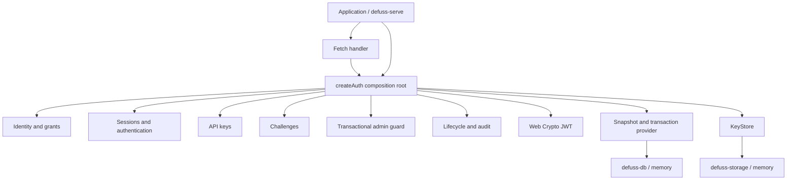

# Architecture

One authority instance composes small operation factories with an explicit context. No global authority, implicit database, dependency injection container, server listener or background scheduler.

## Separation

`auth.ts` is the composition root and owns the clock, configuration fingerprint, crypto key caches, principal capabilities, transaction wrapper, signing and verification path. Operation groups live in `identity.ts`, `sessions.ts`, `api-keys.ts`, `challenges.ts`, `admin.ts`, and `lifecycle.ts`. They share explicit typed functions through `context.ts`. `persistence.ts` separates application profile data from security state. `schema.ts` compiles runtime validation predicates without code generation. `jwt.ts`, `client.ts` and platform-specific entry points stay isolated.

No first-class membership records. Internal grants bind one subject to one tenant, carry exact claims and revision/incarnation/session epochs, and serve only authorization. The physical `profiles` collection stores custom data independently of user, tenant and service security records. A principal is a compact snapshot; lazily hydrate only through a fresh credential-state check. Authenticated requests make no durable writes and never load application profile data unless requested.

## Security transition model

- User/tenant/service status and security epochs invalidate prior credentials. A deleted identity remains a tombstone.
- Removing a grant destroys its incarnation; recreation cannot resurrect a previous credential.
- JWTs bind subject, tenant, session, grant revision and identity epochs. Current signed token, session, signing key, grant, and revocation state are checked within one consistent snapshot.
- API keys bind the subject/tenant grant incarnation and epochs. Effective claims equal the key scope intersected with current grants. A revoked key never becomes active. Key scope can only shrink; changing grant permissions can affect that intersection.
- Refresh, logout, credential creation, reset, claim mutations and key rotation are transactional. A valid consumed refresh replay commits family revocation before rejecting; invalid secrets do not revoke the family.
- Administrative authorization is evaluated on a snapshot, then the guarded read/write repeats the actor credential/step-up checks and compares the target snapshot in the same transaction. Policies depending on external mutable state require their own coordinated transaction; external side effects are forbidden inside a retried transaction.
- Principal methods use a private instance-local WeakMap. They cannot be forged by constructing an object with similar fields. Authorization on a principal describes its original request snapshot; reauthenticate before a new request.

## Provider and key storage

The provider contract requires isolated snapshot reads and atomic serializable write transactions, stable IDs, indexed equality/pagination and rollback. Commit conflicts are retried only when explicitly classified as retryable. No I/O side effects may be performed in callbacks. The memory provider is a reference implementation; native verification against the pinned upstream versions is a release gate.

The default DB collections are users, tenants, services, profiles, grants, credentials, sessions, refresh, apiKeys, challenges, keys, meta, revocations, rates, audit and auditState. History is disabled for security rows. Internal grant IDs use a JSON-encoded tenant/subject tuple (no delimiter ambiguity); native indexes cover email, subject/tenant lookup and expiry.

Private JWKs live in independently encrypted immutable files. File names hex-encode the key thumbprint, because defuss-storage accepts only portable lowercase names and base64url key IDs are mixed-case. The database points at the active key ID and optional encrypted generation. Key creation/rewrap stages and flushes bytes before publication; interrupted writes leave unreachable files, not active partial state. Reconciliation requires exclusive ownership of the namespace across all processes. Public JWKs are retained until the configured conservative token-validity horizon. Imported native CryptoKey objects are cached in bounded maps. Missing/corrupt published key material fails closed.

## Hosting several apps

`defuss-auth/host` opens one authority per app, each with its own directory, database, key files, issuer, audience and policy. The alternative, one authority with the app as another tenant dimension, would share signing keys, policy and failure between apps, and would make deleting an app a row-by-row operation. Tenants stay what they are inside an app: its workspaces. Each app's master key is derived from the host key by HKDF-SHA-256 with the app name as info, so one configured secret serves every app, and a key file never decrypts in another app's directory. VERIFIED: `scripts/host-e2e.mjs`.

The host strips `/apps/<app>` and passes the rest to an ordinary handler. So the refresh cookie's Path is the handler prefix, which is the path the app's proxy mounts and the browser sees. An app proxy authenticates itself with a separate field, because `Authorization` carries the end user's credential. Rate keys come from `X-Forwarded-For` only on such authenticated requests. The socket peer of a proxied request is always the proxy, so a rate key taken from it would put every user behind one limit.

## Performance choices

Cache key imports, parse JWT header once, use native Base64URL where available, compile schemas once, compare canonical sorted claims directly, isolate profiles and keep auth request paths read-only. Deliberately do not use cross-request authorization caches. Signing is kept inside the session mutation transaction so a failed signature cannot commit an unusable refresh successor; cross-collection reads remain sequential to respect the inspected provider transaction scope. These are correctness tradeoffs, not claimed speedups. Audit adds a small ordered transaction record on mutations; no success-path auth request audit write. Benchmark raw memory-provider cost separately from persistent I/O.

## Configuration and migration

Format 2 is not compatible with v0.1 data. Issuer/audience and format cannot silently change. Configuration fingerprints cover schemas, policy, default-tenant behavior, email-flow flags, audit enablement and explicit `policyVersion`. A coordinated migration must name the old fingerprint. Schema migration validates and transforms existing profiles in one transaction, with rollback on failure. The application must coordinate downtime and provider transaction capacity for large stores. Old instances check the fingerprint on subsequent reads/writes and fail closed. Callback code and external policy state cannot be fingerprinted automatically. No v0.1 data import is supplied.
