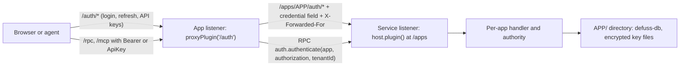

# Hosting authentication for several apps

`defuss-auth/host` runs one authority per app behind one Fetch endpoint. A service such as [defuss-backplane](https://github.com/kyr0/defuss-backplane) can then host user and API key authentication for every app it serves. Each app keeps only a proxy route and one check per request. This page is the integration contract for that service and for an app such as its linear-clone example.

## Request flow

The browser talks only to the app's origin. The app forwards `/auth/*` to the service and asks the service who sent each API call.



Why a proxy instead of a browser calling the service directly: the refresh cookie and the CSRF check then stay on the app's origin, so the page needs no CORS policy and the service listener stays on loopback.

## Service side

```ts
import { join } from 'node:path';
import { createAuthHost, tenantAdmin } from 'defuss-auth/host';

const host = await createAuthHost({
  directory: join(dataRoot, 'auth'),
  masterKey,                                  // 32 bytes from configuration, validated at startup
  credential: { header: 'x-backplane-key', secret: apiKey },
});
await host.open('linear-clone', {
  issuer: 'https://linear-clone.example',
  audience: 'linear-clone',
  http: { mode: 'cookie', allowedOrigins: ['https://localhost:8443'], authorizeAdmin: tenantAdmin('admin') },
});
const server = createServer({ host: '127.0.0.1', port, trustedProxies: ['127.0.0.1'], plugins: [host.plugin(), ...] });
```

1. Mount `host.plugin()` beside the bot-key routes, not inside their wrapper. The user's credential uses `Authorization`, so the proxy proves itself with its own field; the host compares it in constant time and removes it before the handler runs. Cookie mode needs the `Origin` field on every write, so the plugin must not refuse requests that carry one. VERIFIED: `scripts/host-e2e.mjs` answers 403 without the credential field and 403 for a cookie-mode login without `Origin`.
2. Set `trustedProxies` to the loopback addresses of the app proxies. defuss-serve removes `X-Forwarded-For` from other peers, and the host derives rate keys from it only when the credential matched. VERIFIED: without `trustedProxies`, six failed logins from one client all answered 401; with it, the sixth answered 429.
3. Install `defuss-auth`, `defuss-db` 3.2.0 or 3.3.0 and `defuss-storage` 0.4.1 as runtime dependencies. `defuss-auth/server` imports both at runtime, so a bundled copy of defuss-db does not satisfy it. VERIFIED: `make verify` passed with each defuss-db version (2026-11-26).
4. Keep the master key stable. Each app gets its own key, derived with HKDF-SHA-256 from the master key and the app name, so app files moved or renamed into another app's directory do not decrypt. VERIFIED: in `scripts/host-e2e.mjs`, both a different master key and a renamed app directory fail with "Signing key unavailable or corrupt". Rotate with `keyRing` and `rewrapSigningKey`, as for a single authority.
5. Pass `directory` as a canonical path, such as `await realpath(dataRoot)`. Each app directory must be owner-only and reachable without symlinks, ancestors included, or `open` fails; on macOS, `/var` is a symlink to `/private/var`.
6. App names are lowercase `[a-z0-9_-]`, at most 64 characters. A case-insensitive volume would merge `App` and `app` into one directory, so the host refuses uppercase. Map a backplane app name that does not fit.
7. Expose `host.authenticate(app, authorization, { tenantId, claims? })` as an RPC method. It checks the credential against live state and returns plain data: `app`, `subjectId`, `subjectKind`, `tenantId`, `claims`, `method`, `credentialId` and `sessionId`. Expose trusted administration, such as `createUser` or `setClaims`, through `host.get(app)` only to callers that hold the bot key.
8. Call `host.maintain()` about hourly, from a schedule or a timer: it rotates aged signing keys and removes expired rows in every app. Call `host.closeAll()` after the listener stops. Removing the plugin also closes every app.

Functions such as `delivery`, `registration` and `authorizeAdmin` belong in code; keep issuer, audience, origins and policy numbers in configuration. `tenantAdmin(claim)` allows an administrator to act only in the tenant where it holds the claim. It refuses global user routes and tenant routes, so tenant lifecycle stays a trusted call.

## App side

1. Proxy the auth routes: `proxyPlugin('/auth', serviceUrl + '/apps/linear-clone/auth', { headers: { 'X-Backplane-Key': key } })`. `proxyPlugin` ships in defuss-serve 0.5.0. It sets `X-Forwarded-For` from the socket peer and replaces any credential field that a client sends. The path the app mounts must equal the handler's `prefix` (default `/auth`), because the refresh cookie's Path is that prefix.
2. Check every API call: call the service's `auth.authenticate('linear-clone', request.headers.get('authorization') ?? '', { tenantId: workspace })` in the RPC guard and the MCP endpoint, and act as the returned `subjectId`. Pass the workspace's tenant, so a token for another tenant fails. A grant change or revocation takes effect on the next call. VERIFIED: `tests/host.test.mjs`. Checking the JWT offline against the JWKS would accept a revoked token until it expires, up to 15 minutes, and cannot check an API key at all.
3. In the browser, use `createAuthClient({ baseUrl: location.origin + '/auth', mode: 'cookie' })` and send its access token with each API call. The client's `fetch` replays only GET and HEAD after a refresh, so refresh and retry a POST yourself after a 401.
4. Serve the page over HTTPS. VERIFIED: (browser probe, 2026-11-26) WebKit 26.6 does not store the `Secure` refresh cookie on `http://127.0.0.1`, so a reload loses the session; Chromium 153 and Firefox 155 keep it. Use Caddy's local CA for development. Token mode works on plain HTTP but leaves the refresh token in page memory. A page sends `Origin` on every write, so token mode from a page also needs `allowedOrigins`. VERIFIED: WebKit's token-mode login answered 403 until the origin was listed.
5. Give agents API keys: a service account per workspace with a key (`Authorization: ApiKey …`), checked with the same `authenticate` call.

## Without email

Without a `delivery` callback, login, refresh, logout, sessions, tenant switch, password change, step-up and API keys work. Accounts come from trusted calls (`createUser`, `setClaims`) or from `POST /admin/users` by an administrator whose policy allows global routes. Registration and passwordless login refuse to start without delivery, invitations answer 503, and password reset and email verification answer 204 without effect. So there is no self sign-up and no password recovery.

## Verification

VERIFIED: `tests/host.test.mjs` passes on Node.js 26.13.1 and Bun 1.4.4. `scripts/host-e2e.mjs` passed on both runtimes over two real defuss-serve 0.5.0 listeners, the app's being `proxyPlugin`, with real defuss-db, defuss-storage and Argon2id. In it, Chromium 153 and Firefox 155 log in through the proxy in cookie mode and WebKit 26.6 in token mode. UNKNOWN: the integration into defuss-backplane and linear-clone themselves has not run.
